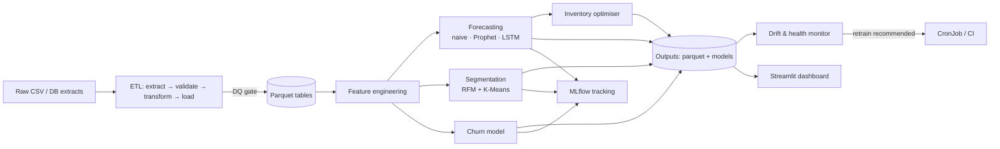

# RetailPulse — AI-Powered Customer Analytics & Demand Forecasting Platform

An end-to-end Data Science & MLOps project for retailers: it ingests sales, customer and inventory data and produces

| Capability | Method | Output |
|---|---|---|
| **Demand forecasting** | Seasonal-naive baseline vs **Prophet** vs **LSTM** (TensorFlow/Keras), best model auto-selected per series by hold-out back-test | 28-day forecast + 80 % intervals |
| **Customer segmentation** | RFM + **K-Means** (k by silhouette) with rule-based business naming | Champions / Loyal / At Risk / Hibernating |
| **Churn prediction** | Logistic regression vs gradient boosting (scikit-learn), leakage-safe time-based labels | Churn probability + risk band per customer |
| **Inventory optimisation** | Safety stock, reorder point, EOQ, stock-out risk, overstock | Per-SKU purchase recommendations |
| **Dashboards** | **Streamlit** + Plotly, incl. a simulated real-time feed | 7-tab interactive app |
| **MLOps** | **MLflow** tracking, drift detection (PSI/KS), data-quality gates, **Docker**, **Kubernetes**, GitHub Actions CI | Reproducible, monitored, deployable |

> **About the data.** The environment this project was built in cannot download third-party datasets, so the repo ships a
> **synthetic but realistic dataset** (≈197 k order lines, 4 000 customers, 48 SKUs, 8 stores, 2 years) generated by
> `src/retailpulse/data/generate.py` (seeded → fully reproducible). It has weekly/yearly seasonality, a festive peak,
> promotions, guest checkouts, returns, duplicate rows and *simulated churn*. **All metrics below are therefore
> demonstrations on synthetic data — re-measure on your own data.** See [Using your own data](#using-your-own-data).

---

## Quick start

### Option A — local Python (≈2 min)
```bash
python -m venv .venv && source .venv/bin/activate      # Windows: .venv\Scripts\activate
pip install -r requirements-dev.txt
make pipeline          # generate data -> ETL -> forecast -> segment -> churn -> inventory -> monitor  (~70 s on 1 CPU)
make dashboard         # http://localhost:8501
make mlflow            # http://localhost:5000  (experiment tracking UI)
make test              # 24 tests, ~20 s
```
No `make`? Use `PYTHONPATH=src python -m retailpulse.pipeline all --with-data` and `streamlit run app/dashboard.py`.

> The ZIP already contains the generated dataset, trained models and pipeline outputs, so you can run
> `streamlit run app/dashboard.py` immediately after `pip install -r requirements.txt`.

### Option B — Docker Compose (MLflow + pipeline + dashboard)
```bash
docker compose up --build        # dashboard :8501, MLflow :5000
docker compose run --rm pipeline all     # retrain on demand
```

### Option C — Kubernetes
```bash
docker build -t <registry>/retailpulse:1.0.0 . && docker push <registry>/retailpulse:1.0.0
# set the image in k8s/*.yaml (or use `kustomize edit set image`), choose an RWX storage class in k8s/storage.yaml
kubectl apply -k k8s/
kubectl -n retailpulse logs job/retailpulse-bootstrap -f      # first training run
```
Includes: dashboard Deployment (2 replicas, probes, resource limits, non-root, read-only data mounts), HPA, PDB, Service,
Ingress (sticky sessions for WebSockets), MLflow server, bootstrap Job and a weekly retraining **CronJob**.

---

## Architecture



```
retailpulse/
├── config/config.yaml            # all tunables (paths, horizons, thresholds, model params)
├── src/retailpulse/
│   ├── data/generate.py          # synthetic dataset generator
│   ├── data/etl.py               # extract / validate (DQ gate) / transform / load
│   ├── features.py               # demand, RFM and churn features (time-safe)
│   ├── models/forecasting.py     # SeasonalNaive · Prophet · LSTM + back-test + auto selection
│   ├── models/segmentation.py    # RFM K-Means
│   ├── models/churn.py           # model comparison, OOF threshold tuning, permutation importance
│   ├── models/inventory.py       # safety stock / ROP / EOQ / risk
│   ├── monitoring/drift.py       # PSI, KS, seasonality-aware demand drift, retrain decision
│   ├── tracking.py               # failure-tolerant MLflow wrapper
│   └── pipeline.py               # orchestration + CLI (`retailpulse <stage>`)
├── app/dashboard.py              # Streamlit app
├── tests/                        # unit + end-to-end tests
├── Dockerfile · docker-compose.yml · docker/entrypoint.sh
├── k8s/                          # manifests (kustomize)
├── .github/workflows/ci.yml      # lint → tests (3.10–3.12) → docker build/smoke → manifest validation
├── data/raw/                     # the dataset (5 CSVs)
├── data/processed/ artifacts/ reports/   # generated outputs (models, parquet, JSON reports)
└── docs/                         # data dictionary & operations runbook
```

## Pipeline stages

`retailpulse <stage>` where stage ∈ `generate-data · etl · forecast · segment · churn · inventory · monitor · all`.

1. **ETL** – schema, key, range, referential-integrity and duplicate checks. Critical failures raise `DataQualityError` and stop the run (report in `reports/data_quality.json`). Removes duplicates, flags returns/guest checkouts, derives revenue/margin, writes Parquet.
2. **Forecast** – daily demand per category (switch `forecasting.level: product` for SKU-level). Every candidate is back-tested on the last 28 days; the best by WAPE is refit on all data. Prediction intervals come from back-test residuals. Category forecasts are allocated top-down to SKUs for the inventory step.
3. **Segment** – log-scaled RFM → K-Means; segments named by rule (recently-active clusters ranked by value; lapsed clusters → *At Risk*/*Hibernating*).
4. **Churn** – features use only data **before** the snapshot date (unit-tested for leakage); label = no purchase in the next 90 days; operating threshold tuned on **out-of-fold** training predictions (the test set is never used for tuning); final model refit on all data and used to score every customer as of today.
5. **Inventory** – `SS = z·σ·√L`, `ROP = d·L + SS`, `EOQ = √(2DS/h)`, order-up-to level, days-of-cover, stock-out/overstock flags.
6. **Monitor** – PSI + KS drift on churn features, **seasonality-aware** demand drift (compares with the same window last year so the festive peak does not raise false alarms), forecast-vs-baseline health → `retrain_recommended` in `reports/monitoring_report.json`.

## Results on the bundled synthetic data (reproducible, seed 42)

**Forecasting** (28-day hold-out, WAPE = lower is better): selected-model mean WAPE **17.7 %** vs 19.7 % seasonal-naive, 18.2 % Prophet, 24.0 % LSTM.
Winners: Prophet for Apparel/Electronics/Grocery, seasonal-naive for Beverages/Personal Care, LSTM for Household.
*Honest note:* on a 2-year daily series the LSTM rarely beats Prophet or a seasonal baseline — that's why selection is automated and the baseline is always a candidate.

**Churn** (25 % untouched test split): ROC-AUC **0.922**, PR-AUC 0.896, precision 0.84, recall 0.73 (threshold 0.56). Logistic regression (CV AUC 0.919) narrowly beat gradient boosting (0.916). Top drivers: recency ≫ 180-day frequency > 90-day frequency. Because churn was *simulated* with a purchase-decay signal, real-world performance will usually be lower.

**Segments:** Champions 1 001 customers → 67 % of revenue; Loyal 1 040 → 18 %; At Risk 854 (lapsed, previously valuable) → 13 %; Hibernating 777 → 2 %.

**Inventory:** 10 high-risk and 4 medium-risk SKUs, 12 overstocked SKUs (≈ $26 k excess capital), 9 091 units recommended to order.

## Configuration

Everything lives in `config/config.yaml`; point `RETAILPULSE_CONFIG` at another file to override. Useful environment variables:
`RETAILPULSE_HOME` (project root), `RETAILPULSE_CONFIG`, `MLFLOW_TRACKING_URI`, `LOG_LEVEL`, `AUTO_BOOTSTRAP` (container).

## Using your own data

Drop 5 CSVs into `data/raw/` (schemas in [`docs/DATA_DICTIONARY.md`](docs/DATA_DICTIONARY.md)) and run `retailpulse all` (without `--with-data`):
`transactions`, `customers`, `products`, `stores`, `inventory`. Public retail datasets (e.g. UCI *Online Retail II*) need a small mapping script to
this schema. Then adjust `churn.snapshot_date` (must be ≥ `horizon_days` before your last transaction date) and, if needed, `monitoring.*`.

## MLOps notes

* **Tracking** – every stage logs params/metrics/artifacts to MLflow; if the server is unreachable the pipeline continues (and warns).
* **Reproducibility** – seeded generator & models, pinned config, deterministic outputs.
* **Quality gates** – DQ checks in ETL; 24 tests incl. leakage, drift behaviour, inventory maths and an end-to-end run; CI on Python 3.10–3.12.
* **Retraining** – the Kubernetes CronJob re-runs the pipeline weekly; the dashboard sidebar surfaces the drift verdict. See [`docs/RUNBOOK.md`](docs/RUNBOOK.md).

## Known limitations / next steps

* Docker/Kubernetes files were validated for syntax but **not executed** in the build sandbox (no Docker daemon) — run `docker compose up --build` once and treat the first K8s apply as a dry run.
* Dashboard has no authentication — put it behind your ingress/SSO (oauth2-proxy, IAP, etc.).
* Models are file-based (`artifacts/`); for multi-team use, register them in the MLflow Model Registry and serve through an API (FastAPI/BentoML).
* Forecast hierarchy is category-level with top-down SKU allocation; for slow-moving SKUs consider Croston/TSB or a global LightGBM model.
* The "live feed" tab replays history; connect it to a real stream (Kafka/Kinesis) for true real-time analytics.
